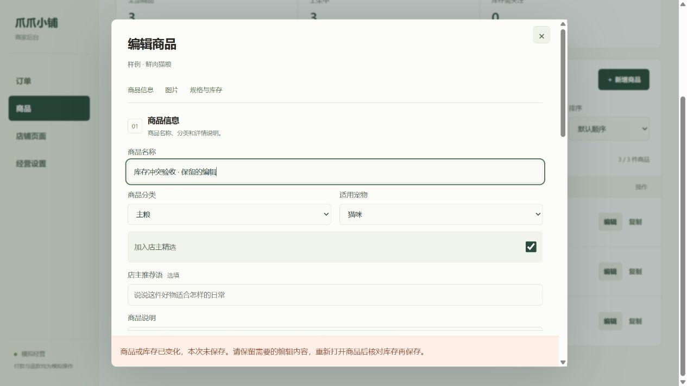
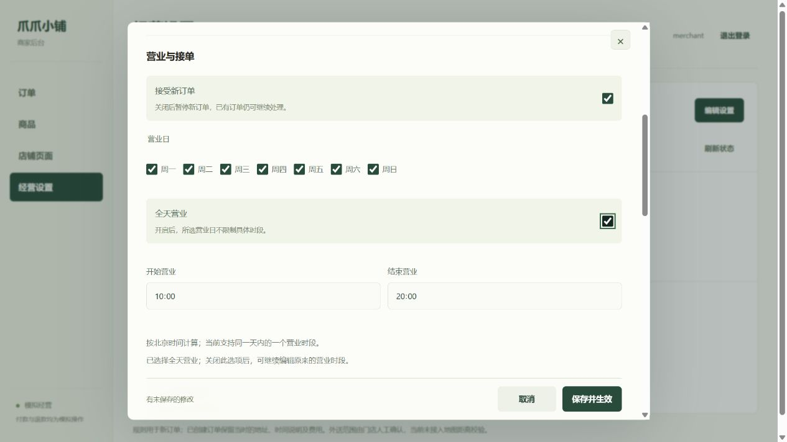

# 经营流程对抗检验与修复验收

日期：2026-10-25。范围：`dev/service` 的商家 Web、当前小程序控制器、HTTP 服务、领域逻辑及 MongoDB。未审核小程序侧尚未提交的本地改动。

## 结论和运行状态

核心模拟经营流程已具备，仍不能按正式上线版本验收。本轮优先修复库存覆盖、跨页面重启重复下单和畸形 URL 导致服务退出；新增回归后共 127 项测试全部通过，包含 9 项真实 MongoDB 集成测试，没有跳过项。

2026-10-25 12:41（北京时间）已由用户手动重启 Node 服务。重启后确认新进程、公网 HTTPS 健康检查、商家商品版本字段和经营设置读取正常；匿名业务请求仍返回 401。现有业务快照与备份哈希一致。本轮后端修复已加载，未对公网发送畸形请求或写入测试订单。

审查中发现本地 MongoDB 进程中断，已使用原持久化目录恢复，未重新播种或清空数据库；中断原因尚未确定。已备份业务快照和上传图片。复核时有 3 件商品、5 笔订单、2 个地址簿、1 条库存流水，业务快照哈希与备份完全一致。此备份不包含账号配置和审计日志，不能替代完整灾备。

## 已修复的问题

| 问题 | 原复现 | 修复与验证 |
| --- | --- | --- |
| P1：旧商品编辑覆盖库存 | 打开库存 20 的编辑页，下单扣到 19，保存旧页又回到 20，取消订单后变成 21 | 商品版本随编辑、下单、取消、过期回补和退货入库变化；旧版本保存被拒绝。取消后正确回到 20；MongoDB 并发编辑仅一个版本提交成功 |
| P1：关闭页面后重复下单 | 服务已创建订单但响应丢失；重新打开页面后生成新 key，产生第二单 | 请求先持久化，按账号与服务地址隔离；重新打开及重新登录复用旧请求。完成记录分阶段写入，覆盖本地存储失败场景 |
| P1：异常 URL 使进程退出 | 向隔离服务发送不能被 URL 解析器处理的请求目标，Node 退出 | 解析异常返回 400；多个异常请求及客户端中途断开后，健康检查仍为 200。未向公网服务发送攻击性请求 |
| P2：库存容量与回补冲突 | 编辑库存或退货入库占满上限，仍有订单待取消回补 | 库存调整和退货入库均计入待回补预留数量；验收失败不记流水，重复验收不重复入账 |
| P2：数据库故障响应不明确 | 数据库异常作为普通 400 返回，客户端可能重新生成下单 key | MongoDB 异常返回可重试 503，隐藏连接细节；保留下单恢复记录 |

已有数据库没有 `revision` 的商品按版本 0 读取，不需要重建数据。旧商家页面缺少版本时会安全拒绝保存，刷新后重新打开商品即可取得版本。买家 API 保持兼容。

真实浏览器中的冲突提示如下。截图来自隔离内存环境，未操作共享业务商品。编辑名称仍保留，保存被拒绝。

## 功能盘点

| 范围 | 现有能力 | 仍缺少的经营能力 |
| --- | --- | --- |
| 小程序侧商品与购物车 | 分类、猫狗筛选、搜索、规格、相册、数量与库存校验、购物车、服务端报价确认 | 当前只有固定商品字段；真实经营所需的品牌、配料、适用年龄、保质期等尚未结构化 |
| 小程序侧账户与订单 | 测试账号登录、地址增删改、订单分页与筛选、取消、模拟付款、收货、售后申请与退货运单 | 微信身份、真实支付、消息通知尚未接入；本次未完成微信真机及开发者工具渲染验收 |
| 商家商品管理 | 模板建品、复制草稿、多规格、元金额输入、实拍上传、备选图片、相册排序、上下架、低库存筛选 | 常规进货、盘点、调拨、报损及原因流水；目前主要记录退货验收入库 |
| 自提与外送 | 分开筛选、待办队列、自提备货与核销、商家送出登记单号或备注 | 外送失败、改约、拒收等异常流程；自提超期处理。外送范围目前为人工判断 |
| 售后 | 申请、撤回、审核、退货、验收、可售/隔离/缺件记账、模拟退款失败与重试 | 部分退款、换货、售后时限；默认退货地址仍应改成可维护的仓库设置 |
| 门店与内容 | 店铺地址、联系方式、营业时间、暂停接单、自提/外送开关、外送费、免运及起送门槛、首页内容和图片 | 经营数据汇总、导出和员工操作审计查询 |
| 数据库与权限 | MongoDB 持久化、事务、幂等键、订单快照、角色与订单归属校验、审计记录、隔离备份恢复测试 | 服务自启动与故障恢复、备份调度与异机副本、细分员工权限 |

## 设计合理性

- 自提与商家外送分开，符合门店自配送模式；无需引入快递公司作为外送必填项。
- 报价、库存和订单状态由服务端裁决；订单保留成交时的价格、地址和履约规则，经营设置修改不会重写历史订单。
- 低 QPS 单店使用 MongoDB 事务和统一写版本可以工作。当前每次业务执行读取全店状态，历史数据增长后开销会增加；先补容量与运营边界，再根据数据量优化查询，不急于引入分布式服务。
- 商家界面围绕待办和表格组织，比展示型首页适合日常操作。商品、经营设置仍使用较长弹层，建议后续改为可保留草稿的分区编辑；冲突处理应进一步提供字段比较和重新载入入口。
- 商品及首页图片具有示意图属性，正式销售时需要实物图与商品资料校验。视觉主题统一不等于商品内容完整。

## 尚未解决的重点

1. **容量限制**：历史订单总数达到 500、新品达到 100 时会触发演示上限，取消的订单也计入历史总数。这是现有模拟限制，本轮未移除；持续联调和正式经营前应调整，同时避免读取全库成为瓶颈。
2. **旧小程序与新经营设置**：未接入动态报价的旧版本可能继续显示写死的 8 元外送费。应先同步 `shopSettings`、`quoteOrder` 和确认逻辑，再修改真实联调费用；当前共享设置未被本轮测试改动。
3. **运维可用性**：本机停机、MongoDB 退出、NATAPP 中断都会影响联调。需要可靠启动、故障检测、恢复流程与备份。进程存活不等于数据库健康。
4. **库存经营与异常履约**：除退货外还需常规入库、盘点及调整理由；缺货、外送失败、无法联系收件人等应有可追溯处理入口。
5. **真实上线依赖**：微信主体、AppID、合法域名与部署、支付及退款、个人信息处理与运营规则需另行接入。模拟付款通过不能当成微信支付验收。

## 冗余与维护负担

- `preview/` 与 `tests/fixtures/legacy/` 是拆分前的合并演示和回归档案，未作为当前公开商家入口。应明确归档范围，避免与当前小程序和商家页面重复维护；不能用旧页面测试数量替代新页面验收。
- 小程序控制器仍有商家编辑相关的遗留字段和方法，虽然无对应商家操作入口，后续可以清理。
- `miniprogram/lib` 中部分文件是构建同步副本，不能只改一份或直接删除；应以构建脚本为准。

## 验证证据和边界

- 完整测试：`PET_MONGO_TEST=1 npm test`，127 通过、0 失败、0 跳过。包括订单归属与角色隔离、非法输入、抢最后一件、同 key 并发、订单状态流转、自提、外送、退款、退货、设置版本、数据库重连与隔离恢复。
- 结构检查：`npm run check`，JavaScript/JSON 与共享领域代码同步检查通过；`git diff --check` 通过。
- 新增回归：`adversarial-regression.test.js`、`checkout-recovery.test.js` 及小程序、商家、MongoDB 集成测试中的新增场景。
- 浏览器：隔离商家页面实测冲突拒绝、表单保留；共享服务仅做只读健康和数据一致性检查。
- 未验证：微信开发者工具渲染、微信真机弱网、真实支付、长期运行及高负载。自动化测试通过不等于这些项目通过。

## 小程序侧同步说明

本次未修改 `dev/miniprogram` 分支，也没有合并 `main`。小程序侧应选择性合并 `services/checkout.js`、`services/api.js`、`pages/shop/index.js` 中的恢复逻辑，并保留自身界面改动；配套接口说明见 [BUYER-API](BUYER-API.md)。未同步时旧接口可以继续使用，但无法获得关闭页面后的防重复下单能力。

## 商家实际操作补充验收

2026-10-25 在同一套商家页面代码的隔离内存环境中，逐项进行浏览器操作。测试订单、商品和经营规则均未写入共享 MongoDB。

| 操作 | 实际结果 |
| --- | --- |
| 外送登记不填单号和备注 | 明确提示必须填写其中一项，订单不改变 |
| 外送只填备注 | 成功送出，显示登记内容，待外送数量从 1 变为 0 |
| 输入错误自提码 | 拒绝核销，仍为待到店自提 |
| 日常用品模板新增商品 | 售价 29.90、库存 12 正确保存，默认草稿，不自动上架 |
| 搜索商品、编辑后取消 | 搜索可定位商品；继续编辑保留输入，放弃修改后不保存 |
| 经营设置保存 | 全天营业和外送费 6.50 正确回显；这是隔离测试值，不是共享门店的新规则 |
| 未发货订单售后 | 审核意见 → 同意申请 → 完成模拟退款，状态和处理记录更新 |
| 390px 窄屏 | 经营设置、订单详情可操作，检查的页面及订单弹层无横向溢出 |

本轮直接修正三个交互问题：

1. 已付款和已送出的订单不再显示“未付款订单 15 分钟自动关闭”；该提示仅用于待付款状态。
2. 开启全天营业后停用开始、结束时间输入；关闭后保留原时段并恢复编辑，避免看似可改但实际不生效。
3. 经营设置新增门店信息、营业接单、自提、外送的分区跳转，减少长表单中的查找和滚动。

改动仅涉及商家网页，不改接口、订单状态机或数据库结构，无需重启 Node，刷新商家页即可载入。完整回归更新为 **129 项通过、0 失败、0 跳过**，结构检查通过；共享业务快照与备份哈希仍一致。

整体判断：日常商品编辑、待办处理和经营设置已可用；长弹层与表格仍有简化空间，不能据此宣称所有终端和全部异常场景都已完成可用性验收。本次没有重新验收图片上传、正确提货码手工核销或微信真机端。

