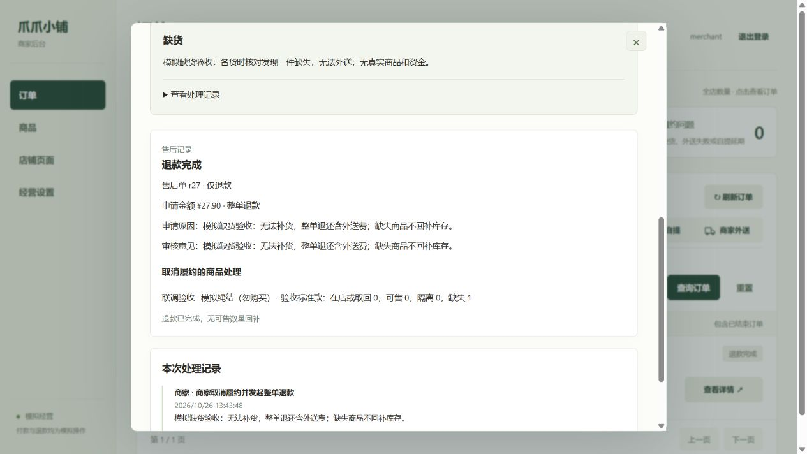
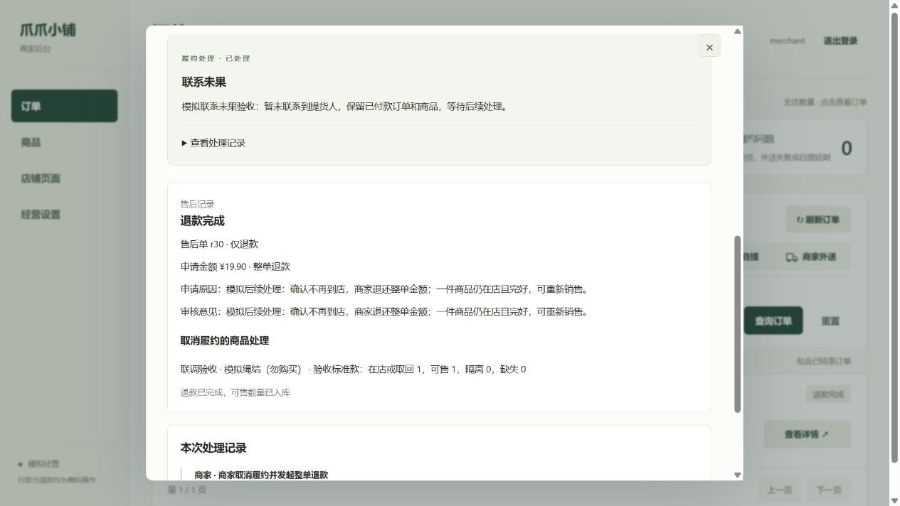

# 异常履约网页验收

2026-10-26，`integration/full-stack`。商家处理通过实际网页完成，买家下单、模拟付款及结果读取通过 HTTPS 接口配合。全部使用专用模拟商品 `p10`，没有真实货物或资金。

| 场景 | 实际网页操作 | 金额与库存结果 |
| --- | --- | --- |
| 备货时缺货 `o24` | 登记缺货；核对实际在店 0 件；故意填写可售 1 件时被拒绝且表单保留；改为 0 件后发起整单退款并完成模拟退款 | 退还 27.90 元，含外送费 8.00 元；缺失 1 件，可售回补 0 件 |
| 联系未果 `o25` | 登记联系未果，订单保持已付款且问题待处理；后续模拟取消自提，核对在店 1 件、可售 1 件，商家发起并完成模拟退款 | 退还 19.90 元；退款成功后回补可售 1 件 |

问题登记后普通发货和备好入口不再显示；问题处理完后从待办移出，保留处理记录。买家读取对应订单可见同样的问题、退款阶段和完成结果。

## 对账与重试

MongoDB 逐条对比本轮开始前的快照：3 个非测试商品、10 笔已有订单、地址簿、经营设置和旧库存流水不变。新增两笔订单均为 `REFUNDED`，问题均为 `RESOLVED`。

专用商品开始为 2 件，两笔订单各预留 1 件；缺货退款回补 0 件，自提取消回补 1 件，最终为 1 件，商品保持下架。每单各有一条 `FULFILLMENT_RETURN` 流水，分别记录增量 0 和 1。

两单退款成功后分别重复调用一次原模拟退款接口；状态、金额和流水数量保持不变，没有重复回补。

## 页面修正

- 退款完成但回补数量为 0 时，明确显示“无可售数量回补”。
- 订单列表的已退款记录显示“退款完成，履约已结束”；已取消或超时订单显示无需履约，避免继续提示配送。

本轮完整测试仍为 228 项通过、0 失败、0 跳过，语法及 JSON 检查 99 项通过。网页修正刷新即生效，无服务接口或数据库结构变更。

## 验收边界

本轮补齐了 [上线前验收](PRELAUNCH-ACCEPTANCE.md) 中缺货、联系未果和商家主动退款的实际网页路径。自提改期、外送失败后再次送出见 [此前网页验收](MERCHANT-LIVE-ACCEPTANCE.md)。买家接口配合不等于新增的真机操作证据；真机弱网、共享服务的新图片校验及登录保护、受管启动和异机恢复仍单独验收。
