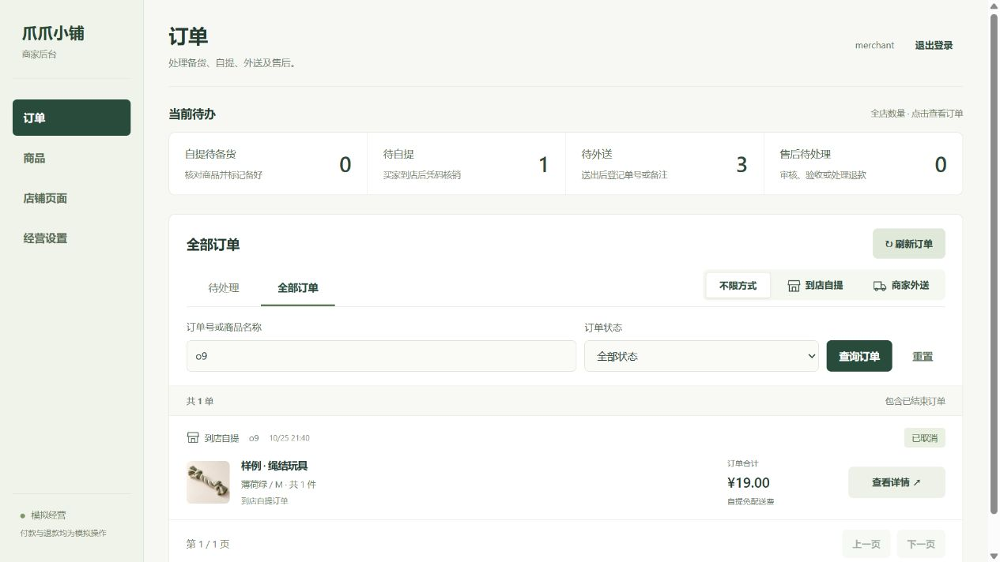

# 小程序侧、商家 Web 与数据库联调

## 联调基线

联调分支：`integration/full-stack`。

- 小程序侧：`dev/miniprogram` 的 `314f764`，包含勾选结算、立即购买、订单进度、地址回跳和联系商家入口。
- 服务侧：`dev/service` 的 `155b64e`，包含商家 Web、HTTP API、MongoDB 持久化、经营设置、库存版本保护及网络异常处理。
- 两侧开发分支和 `main` 保持原样。后续提交先进入各自分支，再合入联调分支验收。

数据库相关代码已经包含在服务侧。Git 只合并代码，不上传数据库、账号、上传文件或备份；没有重建共享数据库或导入种子覆盖现有数据。

## 合并后的行为

- 保留小程序侧的勾选结算与立即购买。仅扣除本次购物车结算的数量；立即购买不改变原购物车。
- 下单前读取服务端报价，由用户确认费用与履约信息；携带设置版本和确认金额，变化时拒绝旧报价。
- 待确认请求按账号和 API 地址持久化。响应丢失、重新打开页面后复用原请求；恢复旧请求先于新购物车的库存校验。
- 门店地址、营业时间、接单状态、自提与外送开关、配送费由服务侧统一提供，取消小程序固定 8 元配送费。关闭当前履约方式时，切换到仍开放的方式。
- 联系商家读取已保存的门店电话和营业时间；未配置时不使用种子示例电话拨号。保留可选本地客服配置作为未设置门店信息时的回退。
- 新增地址保留幂等键；查询有限重试、写操作不自动重发。
- 商品模板和上下架继续在商家 Web。真实收款暂用模拟支付；不新增优惠券、促销、会员价、吉祥物或品牌故事。

## 运行与接入

小程序侧 → HTTPS API → MongoDB；商家 Web → 同一个 API → 同一个 MongoDB。

- 小程序 API：`https://petshop-dev19732.nat100.top`
- 商家 Web：`https://petshop-dev19732.nat100.top/admin/`
- 微信开发者工具导入仓库根目录，编译 `miniprogram/`；使用有权限的 AppID 或工具支持的测试模式。
- 买家账号在小程序登录，商家账号在 Web 登录；使用已有测试账号，凭据通过独立渠道提供。
- 小程序配置 `apiBase` 不加 `/api`。只运行小程序时不用安装 MongoDB。
- 运行主机、MongoDB、Node 和 NATAPP 保持在线。数据库端口不通过隧道开放。

新建分支及拉取代码不会更新已运行 Node 的内存代码。2026-10-25 已由服务侧维护者重启 Node，并验证公网健康与真实模拟器下单；MongoDB 与 NATAPP 未重启。后续修改服务代码后仍需重启相应进程，小程序修改后重新编译。不要在运行服务所用的目录随意切回旧分支。

## 必要闭环验收

1. 商家用模板创建商品、填写价格库存并上架；小程序刷新可见，商家下架后小程序不可购买。
2. 小程序新建地址，勾选商品或立即购买，确认服务端费用，生成订单并模拟付款。
3. 商家看到外送订单，填写单号或备注并标记送出；小程序可查看并确认收货。
4. 自提订单由商家标记备好，小程序显示可提货；错误提货码不能核销，正确核销后两侧状态一致。
5. 未付款取消只释放一次库存。响应丢失后重开页面只恢复一单，不再次占库存，不误扣原购物车。
6. 小程序发起退货，商家审核，买家填写退回信息；商家验收、记录可售入库并模拟退款，两侧订单和库存一致。
7. 商家修改配送费、地址或接单开关，小程序读取最新规则；确认过程中规则变化不能按旧价提交。

## 2026-10-25 验证记录

- 完整测试 163 项通过，0 失败、0 跳过，包含原有 10 项 MongoDB 集成测试和新增 2 条三方闭环测试。
- 三方闭环执行实际小程序页面控制器、请求适配器、商家 Web 操作函数和 HTTP 服务，使用独立测试 MongoDB。wx 和 DOM 使用测试适配器，不冒充真实微信渲染或人工点击验收。
- 覆盖模板建品、动态门店设置、外送付款送出收货、退货入库退款、自提备货核销、取消释放、最后一件商品丢失响应恢复、立即购买不扣原购物车。
- 测试库独立创建并清理；共享业务快照与验收前备份一致。
- 微信开发者工具已编译并登录联调版本，实际完成商品浏览、立即购买、自提报价、创建订单与取消；商家网页和 MongoDB 同步核对通过。真机与全部履约售后的实际界面验收仍需继续，不能由自动测试代替。
- 真实微信登录、支付、退款和订阅通知不在本轮模拟验收内。

运行完整测试（先启动本地 MongoDB）：

```powershell
$env:PET_MONGO_TEST='1'
npm.cmd test
npm.cmd run check
```

测试默认只清理本次创建的 `pet_shop_test_*` 数据库，不操作共享业务库。共享环境手动验收使用明确标记的模拟订单，保留操作记录，不批量清库。


## 重启后的实际界面验收

2026-10-25 21:40—21:43（北京时间），微信开发者工具中的小程序连接既有 HTTPS 联调服务：

- 立即购买一件绳结玩具，选择自提，确认商品金额 19 元、自提费 0 元；门店信息与服务侧一致。
- 使用“联调验收1025”标记创建模拟订单 `o9`，小程序、商家网页、MongoDB 均显示待付款及总额 1900 分。
- 商品库存从 25 变为 24；在小程序取消订单后，两侧显示已取消，数据库库存回到 25。
- 原有 5 笔订单、地址及售后入库记录与验收前一致；保留新增的一笔已取消订单，不删除业务历史。商品版本随预留和释放正常增加。
- 未发生真实付款；本次实际界面验收不等同于完整支付、核销及售后界面均已人工走通。完整模拟流程的隔离自动测试结果见上文。


