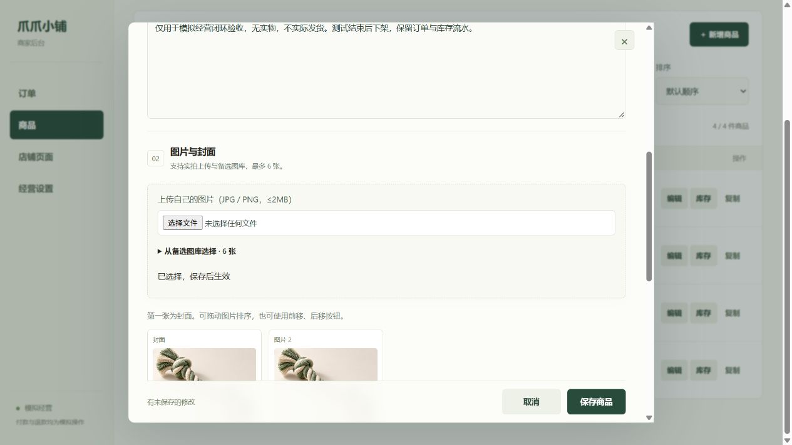
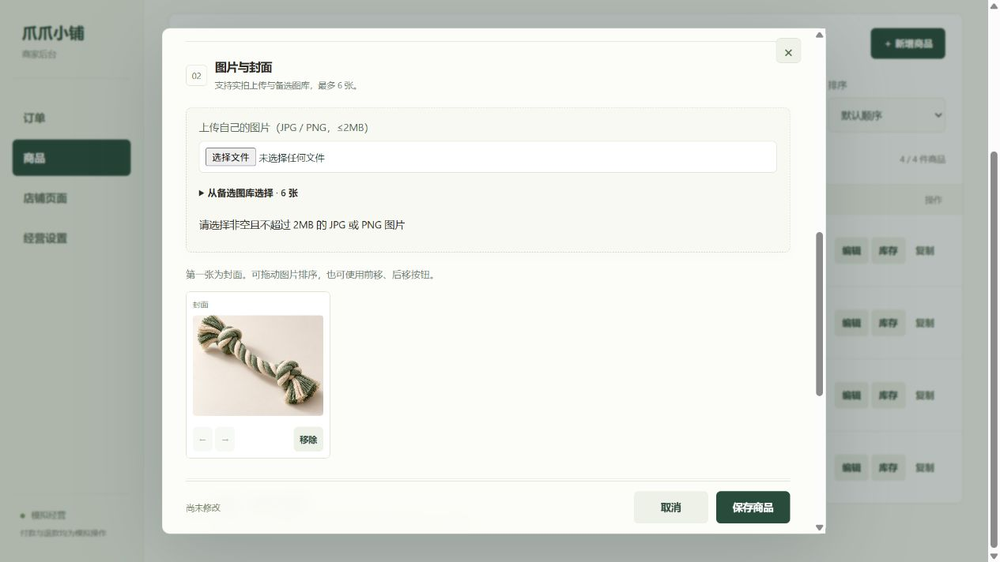

# 商品图片上传验收

2026-10-26，`integration/full-stack`，商家网页通过现有 HTTPS 隧道连接共享服务。

## 实际网页操作

- 在下架的模拟商品 `p10` 中选择超过 2MB 的 PNG 文件，页面拒绝上传并说明大小和格式要求。
- 选择文本文件，页面拒绝上传，原图片、规格及商品说明不变。
- 选择项目内已有的玩具 JPG 示意图，上传完成后出现封面预览；点击保存商品，页面确认保存为草稿。
- MongoDB 中封面指向新的 `/uploads/` 文件，旧图片保留在相册中。公网返回 `image/jpeg`，文件内容与上传源逐字节一致。
- 3 个非测试商品、10 笔订单、库存、地址簿及经营设置与验收前一致。测试商品仍下架，可售库存仍为 2。

## 修复与自动验证

上传结束后清空文件控件的选择状态，允许重新选择同一张图片重试。网络失败保留原图和已填内容，并给出重试说明；上传不自动重试，避免响应丢失时重复发送。文件读取取消也会解除上传状态。

相册已有 6 张时在读取、上传前提示先移除图片；空文件、超过 2MB 或类型不支持的文件提前拒绝。文件选择事件本身不再标记“有未保存的修改”，成功写入图片草稿后才标记。

新增测试覆盖断网后重试同一文件、保留表单、上传成功后更新草稿、无效文件、相册容量、读取取消，以及迟到的旧上传结果不得修改新打开的商品。上传中仍阻止保存商品。

完整测试为 223 项通过、0 失败、0 跳过，包含独立 MongoDB 测试；98 项语法和 JSON 检查通过。实际网页验证与注入故障的自动测试分开记录：本轮没有切断共享服务或 NATAPP 来制造断网。

## 边界

上述网页操作时运行的服务仅校验大小、Base64 编码与 PNG/JPEG 文件头。上传控件修复刷新商家页面即生效。之后已重启并完成下述共享服务验收；早期上传文件保持原样。

## 服务侧完整解码补充

上传改为异步完整解码后写入，不再仅凭文件头接收文件。固定依赖 `sharp@0.35.5`，使用严格解码检查与 4000 万像素上限，同时只处理 2 张图片，超出并发返回 503 与 `Retry-After`，不无限排队。配置依据 [Sharp 输入文档](https://sharp.pixelplumbing.com/api-constructor/)。

正常图片按 EXIF 朝向校正，最长边缩至 2048 像素（小图不放大），重新编码为 JPG 或 PNG；PNG 保留透明度。输出不保留 EXIF、GPS 等原始元数据，处理后仍要求不超过 2MB。重新编码默认去除元数据的行为见 [Sharp 输出文档](https://sharp.pixelplumbing.com/api-output/)。旧的已上传文件保持原样。

新增独立测试覆盖正常 PNG/JPEG、透明度、朝向及元数据去除、伪造文件头、截断文件、非法编码、像素超限、并发拒绝及失败释放名额。HTTP 测试确认响应返回前文件已经落盘、可读取且可解码，拒绝坏图后健康检查仍成功。

补充后完整测试 228 项通过、0 失败、0 跳过；语法及 JSON 检查 99 项通过。2026-10-26 经确认重启后，公网接口验证了损坏 JPEG 拒绝、正常图片朝向校正、元数据去除及落盘后立即可读，见 [重启验收](RESTART-LIVE-ACCEPTANCE.md)。

请求与响应字段保持不变。仅支持 JPG/PNG；HEIC、GIF 等格式仍需先导出为 JPG/PNG，不宣称支持全部手机相册格式。
