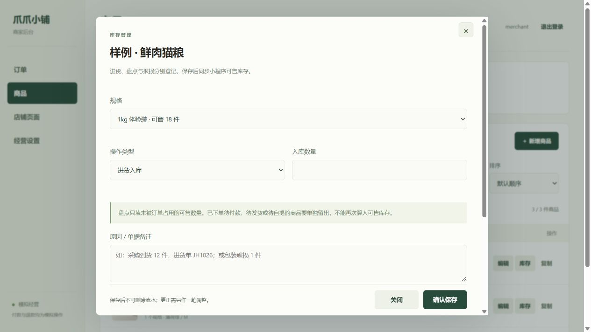

# 库存入库、盘点与报损

商品列表的「库存」入口用于日常进货、盘点和报损。商品编辑负责名称、图片、规格与价格；新商品、新规格仍可填写初始库存。已有规格的库存通过专门入口调整，避免把旧编辑页中的数量写回去。

## 操作口径

| 操作 | 填写内容 | 库存变化 |
| --- | --- | --- |
| 进货入库 | 本次验收可售的数量，必须大于 0 | 当前可售数加本次数量 |
| 可售库存盘点 | 盘点后的可售数量，可填 0 | 改为盘点数量 |
| 报损出库 | 本次从可售库存移出的数量，必须大于 0 | 当前可售数减本次数量 |

盘点必须单独留出订单已占用的商品。待付款、待发货和待自提商品已经从可售库存扣除，不能重复计入。数量变动即使为 0，确认盘点也会保留记录。订单取消及超时释放仍由原订单流程处理。

每笔记录保留商品、规格、变动前后数量、原因、操作账号和时间。流水不能通过商家页面删除或改写；录错时重新登记更正原因。退货验收记录继续使用原来的流水，不伪造历史入库；上线此版本之前未记录的商品编辑不会补造记录。

## 接口与兼容

- `identity` 为商家增加 `capabilities: ["inventory-v1"]`。没有此标记时，新 Web 禁用库存入口，保留旧商品编辑能力；小程序不依赖这个新增字段。
- `adjustStock` 仅商家可调用。参数为 `productId`、`skuId`、`revision`、`type`、`quantity`、`reason`、`requestKey`；`type` 为 `RECEIVE`、`COUNT`、`LOSS`。
- `revision` 必须是读取到的当前商品版本。期间发生下单、取消、退货入库或商品修改时，旧版本调整被拒绝；重新核对后再填写，不能自动覆盖。
- `requestKey` 是 8～80 位字母、数字、下划线或横线。相同商家、相同键和参数重试返回原流水；改参数复用键会拒绝。网页在发送前保存请求，响应不确定时锁住原表单，可点击「核对原提交」。刷新页面后从库存入口恢复。会话存储不能写入时，不发送库存写请求。
- `stockHistory` 仅商家可调用。支持 `productId`、`type`、`page`、`pageSize`，每页最多 50 条；MongoDB 通过索引分页读取。
- 保留旧 `saveProduct` 的参数和版本检查。旧客户端调整库存也会记录 `PRODUCT_EDIT`，可选 `stockReason`；新商品和规格的非零初始数量记录为 `INITIAL`。
- 小程序现有商品、订单和地址接口不改名、不删字段。库存、流水与重试记录在同一 MongoDB 事务中保存。

## 验证记录（2026-10-26）

- 完整测试 172 项通过，0 失败、0 跳过。原有 163 项测试继续通过；新增库存数量、权限、容量、版本冲突、幂等、旧接口记账、分页、网页重开恢复和 MongoDB 并发验证。
- 三方接口验收：商家入库后，小程序请求读取新库存，下单扣减，取消释放；原入库请求重试不重复记账，数据库数量和流水一致。
- 新流程测试使用独立测试库。共享库仍保留既有 6 笔订单，商品数量、原有订单、地址及退货入库记录未被本轮测试更改。
- 浏览器检查了库存表单布局、字段提示以及旧服务版本下禁用新入口的行为。尚未在更新后的共享 Node 上完成新库存功能的实际点击保存验收。

下图只展示布局；不作为新接口已经部署或实际点击入库成功的证据。

