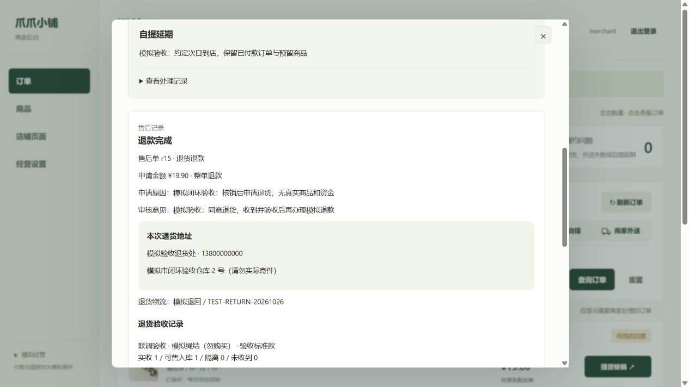
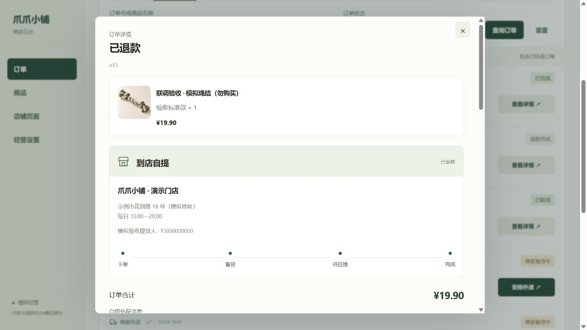

# 商家网页现场验收

2026-10-26，在正在运行的 HTTPS 商家网页实际点击完成以下操作，随后读取 MongoDB 核对结果。买家下单、模拟付款、售后申请、提交退货和确认收货使用测试账号调用当前 HTTPS 接口。小程序模拟器仍停在登录页，因此这里仅确认商家界面和共享服务闭环，不宣称小程序全程点击已通过。

## 测试记录

使用玩具模板新建 `p10`「联调验收 · 模拟绳结（勿购买）」，价格 ¥19.90，规格“验收标准款”。描述明确标注无实物、不实际发货。原有商品和订单不用于本轮测试。

| 操作 | 实际结果 |
| --- | --- |
| 模板建品、上架 | 商品保存成功，买家商品接口可读取，初始库存 2 |
| 进货入库 | 网页预览并保存 2 → 4，独立入库流水生成 |
| 自提订单 `o13` | 模拟付款 ¥19.90，库存 4 → 3；商家标记备好 |
| 自提延期 | 登记延期、约定次日时间、恢复履约；订单保留，库存不释放 |
| 提货核销 | 错误码被拒绝；正确码后订单完成，库存仍为 3 |
| 退货退款 `r15` | 商家批准模拟退货地址；买家提交模拟退回单号后进入验收 |
| 退货验收 | 实收 1、可售入库 1，库存 3 → 4；仅产生一条退货入库流水 |
| 退款失败重试 | 网页模拟失败后重试成功，整单模拟退款 ¥19.90，库存仍为 4 |
| 外送订单 `o17` | 商品 ¥19.90 加外送费 ¥8.00，模拟付款总计 ¥27.90，库存 4 → 3 |
| 外送失败重送 | 首次单号 TEST-DELIVERY-01；登记未送达后再次送出 TEST-DELIVERY-02，旧单号及备注保留 |
| 确认收货 | 买家接口确认后订单 COMPLETED，履约问题 RESOLVED，库存仍为 3 |
| 报损与盘点 | 报损 1 件：3 → 2；模拟盘点更正：2 → 3，两笔流水分别保留 |
| 下架 | 测试商品保存为草稿，买家商品列表恢复原有 3 件；测试订单与流水保留供追溯 |

新增一条明确标注“请勿实际配送”的模拟地址。没有使用真实收货信息，也没有真实支付、退款、配送或寄件。

## 数据核对

- 原有 3 个商品、6 笔订单逐条与操作前基线比较，内容完全一致。
- 原有地址条目、库存流水、支付事件及请求幂等记录逐条保留，未被覆盖。
- 经营设置、首页内容等原有元数据未变；仅业务序号和修订随正常写入推进。
- 新增 1 个已下架商品、2 笔已结束订单、1 条模拟地址和 5 条库存流水。
- 测试商品最终可售库存 3。自提单已退款，外送单已完成；没有遗留本轮测试的待付款、待履约或待售后订单。

本轮数据库只读核对结果与基线保存在本机私有验收目录，未上传账号、令牌或数据库快照。

## 发现并修复

已完成自提的订单申请售后后，原网页只根据当前订单状态绘制进度，把“完成”节点变回未完成。现在结合核销时间和售前状态保留实际履约进度；未付款就取消的订单也不再误显示已备货。实际刷新网页后确认修复，新增回归覆盖自提、外送和未付款关闭。完整 220 项测试通过。

## 仍待验收

- 小程序登录后的真实页面点击与真机网络切换。
- 缺货、联系未果以及商家主动退款的网页路径；这些已有自动化覆盖，本轮未实际点击。
- 图片上传实际页面路径及真实商品资料核对。
- 受管服务切换、主机登录恢复、异机备份；后端登录保护仍待统一重启生效。
