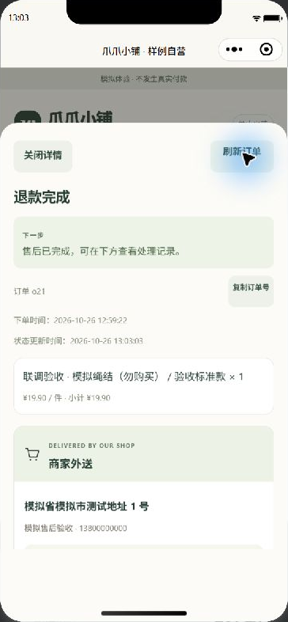
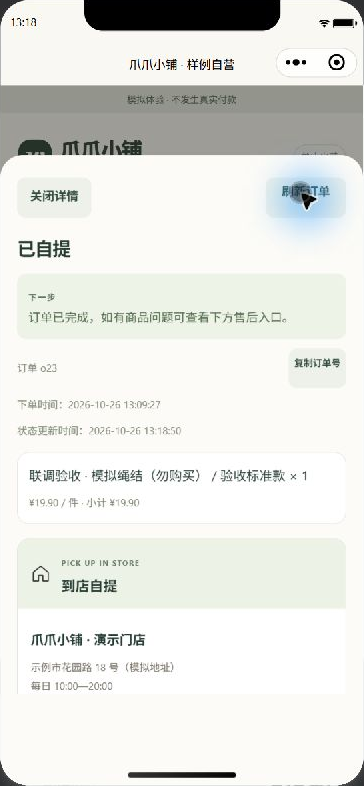

# 小程序模拟器现场验收

日期：2026-10-26。分支：`integration/full-stack`。

本轮在已登录的微信开发者工具中点击小程序页面，通过 HTTPS 隧道连接共享 Node 服务和 MongoDB。买家动作均由实际页面完成；商家配合动作使用已授权测试账号调用接口。商家网页的实际点击证据另见 [商家网页现场验收](MERCHANT-LIVE-ACCEPTANCE.md)。全部为模拟付款、模拟发货和模拟退款。

## 已完成的路径

| 路径 | 实际操作与结果 |
| --- | --- |
| 外送购买 | 选购模拟商品、选择已有地址、提交订单并模拟付款；订单 `o21` 商品 19.90 元、外送费 8.00 元，合计 27.90 元 |
| 外送收货 | 商家登记配送信息后，小程序刷新显示单号 `MINI-DELIVERY-20261026`，买家确认收货 |
| 退货退款 | 小程序提交退货退款申请；商家审核后，小程序填写退回单号；商家验收可售入库 1 件并模拟退款，小程序刷新显示退款完成，退还 27.90 元 |
| 到店自提 | 小程序选择自提并填写提货联系人，订单 `o23` 合计 19.90 元、外送费为 0；付款后显示提货码，备货后刷新为待到店自提，核销后刷新为已自提 |
| 门店信息 | 登录后实际查看门店地址、电话、营业时间以及自提和外送规则 |

## 本轮修复

- 页面内切换到结算、订单、分类等视图时回到顶部，避免继承上一视图的滚动位置而遮住标题、商品或操作入口。
- 售后类型选择器绑定当前类型，保持弹出选中项与页面文字一致。
- 不修改服务侧接口、订单结构或数据库结构。

## 数据核对

测试使用专用模拟商品 `p10`，结束后已下架。可售库存由 3 件开始：外送下单减 1、退货验收入库加 1、自提下单减 1，最终为 2 件。新增退货入库流水只有 1 条。

直接读取 MongoDB 与本轮开始前的快照逐条比较：原有 8 笔订单、3 个非测试商品、地址簿、原有库存流水和幂等记录保持一致；经营设置保持一致。新增两笔订单保留用于追溯，没有清库或重置库存。

完整自动测试 220 项通过，0 失败、0 跳过，包含独立 MongoDB 测试；语法与 JSON 检查 98 项通过。开发者工具自动重新编译后实际继续操作成功，登录状态保留。

## 页面证据

| 退货退款完成 | 自提核销完成 |
| --- | --- |
|  |  |

## 未覆盖事项

本轮不替代真机网络切换、图片上传失败路径、实际门店资料、异机备份及主机重启恢复验收。最新登录保护仍需统一重启后验证，受管启动切换也尚未完成。剩余项目持续记录在 [上线前验收](PRELAUNCH-ACCEPTANCE.md)。
