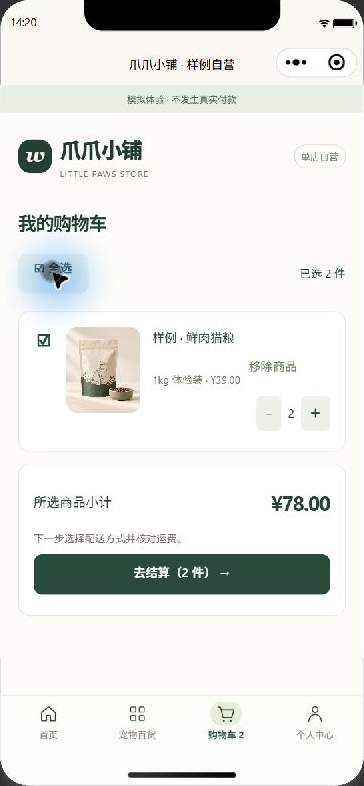
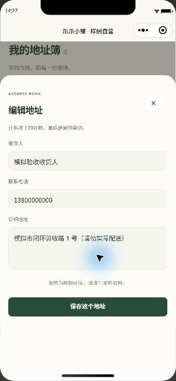
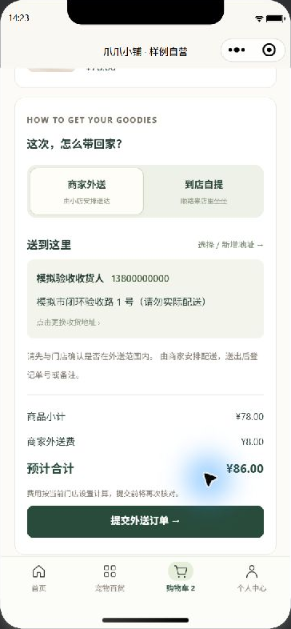
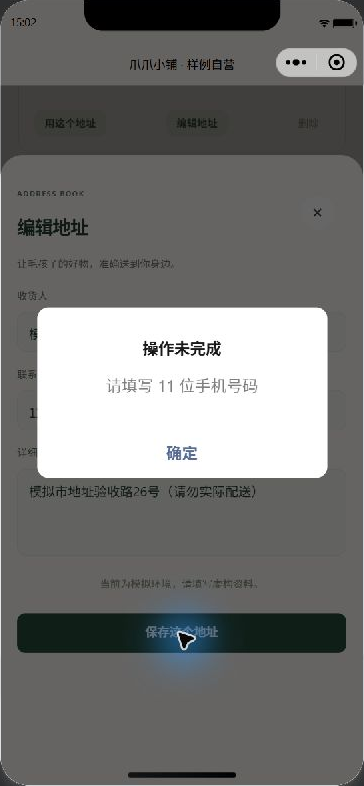
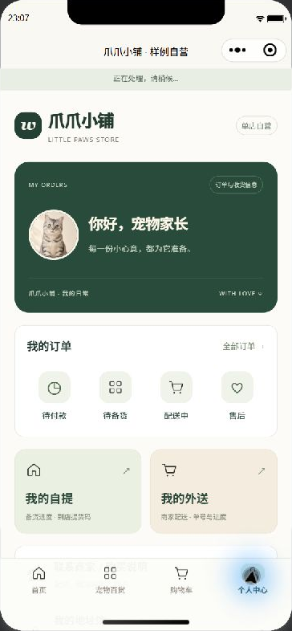

# 小程序模拟器现场验收

日期：2026-10-26。分支：`integration/full-stack`。

本轮在已登录的微信开发者工具中点击小程序页面，通过 HTTPS 隧道连接共享 Node 服务和 MongoDB。买家动作均由实际页面完成；商家配合动作使用已授权测试账号调用接口。商家网页的实际点击证据另见 [商家网页现场验收](MERCHANT-LIVE-ACCEPTANCE.md)。全部为模拟付款、模拟发货和模拟退款。

## 已完成的路径

| 路径 | 实际操作与结果 |
| --- | --- |
| 外送购买 | 选购模拟商品、选择已有地址、提交订单并模拟付款；订单 `o21` 商品 19.90 元、外送费 8.00 元，合计 27.90 元 |
| 外送收货 | 商家登记配送信息后，小程序刷新显示单号 `MINI-DELIVERY-20261026`，买家确认收货 |
| 退货退款 | 小程序提交退货退款申请；商家审核后，小程序填写退回单号；商家验收可售入库 1 件并模拟退款，小程序刷新显示退款完成，退还 27.90 元 |
| 到店自提 | 小程序选择自提并填写提货联系人，订单 `o23` 合计 19.90 元、外送费为 0；付款后显示提货码，备货后刷新为待到店自提，核销后刷新为已自提 |
| 门店信息 | 登录后实际查看门店地址、电话、营业时间以及自提和外送规则 |

## 本轮修复

- 页面内切换到结算、订单、分类等视图时回到顶部，避免继承上一视图的滚动位置而遮住标题、商品或操作入口。
- 售后类型选择器绑定当前类型，保持弹出选中项与页面文字一致。
- 不修改服务侧接口、订单结构或数据库结构。

## 数据核对

测试使用专用模拟商品 `p10`，结束后已下架。可售库存由 3 件开始：外送下单减 1、退货验收入库加 1、自提下单减 1，最终为 2 件。新增退货入库流水只有 1 条。

直接读取 MongoDB 与本轮开始前的快照逐条比较：原有 8 笔订单、3 个非测试商品、地址簿、原有库存流水和幂等记录保持一致；经营设置保持一致。新增两笔订单保留用于追溯，没有清库或重置库存。

完整自动测试 220 项通过，0 失败、0 跳过，包含独立 MongoDB 测试；语法与 JSON 检查 98 项通过。开发者工具自动重新编译后实际继续操作成功，登录状态保留。

## 页面证据

| 退货退款完成 | 自提核销完成 |
| --- | --- |
|  |  |

## 未覆盖事项

本轮不替代真机网络切换、异机备份及主机重启恢复验收。登录保护和完整图片解码已在后续 [共享服务重启验收](RESTART-LIVE-ACCEPTANCE.md) 中确认生效；图片失败路径见 [图片验收](IMAGE-UPLOAD-ACCEPTANCE.md)。当前全部使用模拟信息，受管启动切换尚未完成。剩余项目持续记录在 [上线前验收](PRELAUNCH-ACCEPTANCE.md)。

## 重启后的购物车与地址页面补充

2026-10-26，维护者重新登录买家账号后，通过实际开发者工具完成以下点击检查，没有调用页面内部方法替代操作：

- 空购物车显示引导；从分类页打开猫粮规格，加入 1 件，购物车显示 39.00 元。
- 增加到 2 件，小计为 78.00 元；取消勾选后数量为 0、小计为 0、结算按钮禁用；全选后恢复 2 件与 78.00 元。
- 进入结算并打开地址簿，编辑已有模拟地址时正确回填收货人、电话及详情；关闭表单未保存。选择另一个地址后返回确认订单，地址更新，商品及数量保留，页面回到顶部。
- 外送显示商品 78.00 元、配送费 8.00 元、合计 86.00 元；切换自提后配送免费、合计 78.00 元。滚动到底部时提交按钮完整可见。
- 返回购物车后仍保留 2 件未提交商品。此次只改变模拟器本地购物车和选择状态，未提交订单或保存地址。MongoDB 全部业务集合与重启前快照一致，仍为 12 笔订单、9 条库存流水。

此补充验证购物车至结算、地址回填与切换的页面衔接。地址新增保存已在下方后续验收补齐；修改保存和删除的实际点击尚未在此轮覆盖。真机软键盘及网络切换也未覆盖。

## 地址保存与刷新失败修复

发现并通过失败测试复现：结算中新增地址已成功保存，但随后刷新地址簿的请求失败，旧实现会返回结算并选中旧地址。修复后先用保存接口返回的数据更新本地地址簿与选中项，再刷新门店与商品；刷新失败时仍保持禁止下单，恢复连接后保留新地址选择。没有新增接口或数据库字段。

回归测试模拟保存成功、刷新失败、禁止下单、刷新恢复及最终提交，确认只保存一次地址，最终下单使用新地址 ID。全量 229 项测试通过，0 失败、0 跳过；99 项语法及 JSON 检查通过。

正常网络下，在实际小程序模拟器中从购物车结算进入新增地址，填写明确标注的虚构信息并保存，页面自动返回结算且选中新地址。MongoDB 确认新增地址 `a32`，只新增一条对应幂等记录和一条审计记录，原地址、12 笔订单、商品及库存均保持不变。此截图证明实际正常保存路径；断网路径由故障注入回归验证，没有中断共享服务制造故障。

## 地址修改与错误输入验收

2026-10-26，在实际模拟器中编辑专用模拟地址 `a32`。联系电话填成 `123` 后，服务拒绝保存，但页面原先直接显示 `ADDRESS_PHONE`。已在小程序接口适配层补齐姓名、手机、详细地址和未选地址的中文说明，保留原错误码及重试判断，不改服务接口或数据库结构。

重新编译后的实际页面显示“请填写 11 位手机号码”。关闭提示后，编辑窗口和已填内容保留。两次错误提交前后，数据库业务集合与快照完全一致。

恢复有效模拟号码，将该地址详情的门牌号由 26 改为 27 并保存，页面自动返回结算并选中修改后的地址。数据库只更新 `a32` 的详情和一次版本号、审计记录；没有新增地址或订单，原有 12 笔订单、商品、库存及其他地址不变。

新增回归覆盖中文提示、不自动重发错误保存，以及失败保留表单、修正后再次保存。全量 231 项测试通过，0 失败、0 跳过；99 项语法及 JSON 检查通过。地址删除和真机软键盘、网络切换仍待验收。

| 无效号码提示 | 地址修改后返回结算 |
| --- | --- |
|  |  |

## 重新登录与加载布局检查

2026-10-26 晚，在实际开发者工具中使用 buyer 测试账号重新登录。商品及图片正常加载，购物车为空；个人中心进入订单列表后，“全部”显示该账号的 9 笔订单，“售后”显示 5 笔。地址簿显示 3 条地址，专用地址 `a32` 保留此前修改的 27 号详情。重新编译后会话保留。

现场发现请求中的提示条会占据页面高度，消失时把订单入口等按钮向上推移。将提示改为页面顶部的固定状态条，不占内容布局、不拦截点击。重新编译后，在个人中心观察请求开始与结束，订单、自提和外送入口位置保持一致。仅调整小程序模板和样式，接口、数据结构及服务进程不变；99 项语法和 JSON 检查通过。

HTTPS 健康检查返回模拟模式、MongoDB 正常。只读数据库核对确认仍为 12 笔总订单，商品、库存流水及地址与此前验收结果一致。本轮尚未执行地址删除，也不覆盖真机网络切换和软键盘。

| 请求中 | 请求完成 |
| --- | --- |
|  |  |

## 地址删除现场验收

2026-10-26 晚，获得专用测试地址的删除确认后，在实际小程序地址簿中找到“模拟市地址验收路27号（请勿实际配送）”，点击删除，并在确认框中继续。页面正常刷新，地址数由 3 变为 2，原来两条地址仍可见。

操作前保存 MongoDB 全集合快照，操作后逐条比对：仅买家地址簿移除 `a32`、设置版本递增一次、审计增加一条 `deleteAddress`；12 笔历史订单（包括地址快照）、商品、库存流水、幂等记录和其他集合均未变化。此次没有修改实现，也没有通过接口替代界面删除。

地址新增、修改与删除的模拟器点击路径至此均已覆盖。真机软键盘、网络切换仍需单独验收。

