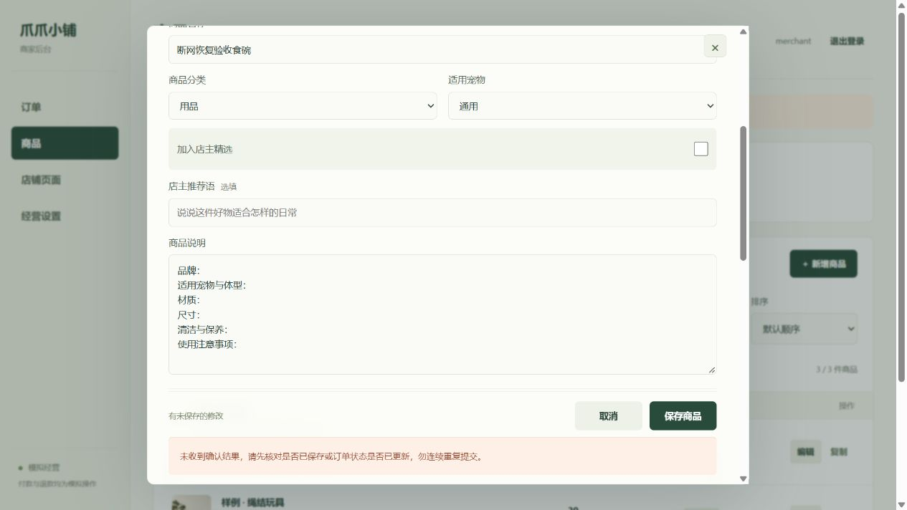

# 网络与数据可靠性

2026-10-25。本轮不新增营销或展示功能，范围按 [必要功能](SCOPE.md) 执行。

## 请求策略

商家网页每次请求最多等待 15 秒，覆盖读取响应内容的过程。小程序使用 15 秒请求超时。商品、订单、设置等明确的读取动作遇到断网、网关异常或服务暂不可用时，等待 300 毫秒后最多重试一次；一次操作最多两次请求。权限错误、参数错误和业务冲突不自动重试。

保存、下单、履约、售后、上传和登录不自动重发。超时不等于服务端没有写入：商家会看到“未收到确认结果”，需先核对商品或订单；表单保留。小程序下单继续使用已持久化的原请求和原 key 恢复，不生成第二单。

新增商品及新增地址支持可选的 `requestKey`。同账号、同动作、同 key、相同输入重试返回原结果，不再次新增；已提交后改变输入则返回 `CREATE_REQUEST_CONFLICT`。旧请求不增加必填参数。商家网页和小程序地址表单会为每次新建生成键，在当前编辑过程内复用；关闭表单后重新新建不属于同一次重试，应先查询列表。商品新增不宣称支持跨浏览器重启的草稿恢复。

订单操作进行中会锁定控件并拦截重复点击，完成或失败后恢复操作。切换小程序账号后，旧请求返回的 401 不清掉新账号会话，迟到的旧账号数据也不回填。

## 服务与数据库

- HTTP 可以先启动，MongoDB 未就绪时健康和业务请求返回 503，不排队保存写请求。数据库连接按 1、2、4 秒逐步延长重试间隔，最长 30 秒；配置错误需修正后重启。
- 已建立连接后的短暂断连由 MongoDB 驱动恢复，健康检查真实执行数据库 ping，不仅检查 Node 进程是否存在。
- MongoDB 连接选择、建立连接及等待连接池分别限制为 5 秒；网络 socket 等待上限 10 秒；事务整体预算 12 秒。事务超时或提交结果不确定仍按不确定写入处理，客户端不得换 key 重发。
- HTTP 请求体接收设为 20 秒、请求头 10 秒、空闲 keep-alive 5 秒。它们不代表所有业务操作统一在这个时间内结束。
- 非法 URL、损坏 JSON 和非对象 JSON 返回明确错误；内部错误不向客户端回传本机文件路径或数据库连接详情。
- 正常停止服务时先停止接单和后台任务，再关闭数据库连接。

这些措施能改善网络抖动和启动顺序问题，不能替代进程守护。2026-10-26 已切换受管入口并登记系统登录恢复任务，后端退出以及守护器退出后的恢复均已实测，具体行为和待验收的主机重启触发见 [服务启动与恢复](RUNTIME-RECOVERY.md)。Node 内的自动备份已首次成功执行。

## 验证和部署

本轮完整测试 141 项通过、0 失败、0 跳过，其中真实 MongoDB 集成测试 10 项通过。共享数据库只读比对与验收前备份一致。

故障注入测试覆盖读取恢复、重试上限、写入超时不重发、迟到会话响应、数据库延迟就绪和恢复、损坏请求及重复操作。真实 MongoDB 集成测试覆盖并发新增幂等、重连、库存事务和经营流程。没有停止共享 MongoDB 或向公网发送故障注入请求。

浏览器隔离验收还模拟了两次读取失败后恢复，以及商品已创建但返回错误的情况：页面提供重新加载入口，失败表单保留；同一次新增再次提交后仍只有一件商品。修复了错误提示遮挡保存按钮的问题，反馈与按钮现在位于同一底部操作区。

商家网页文件刷新即可加载。服务启动策略、数据库等待上限及新增幂等处理需要重启 Node 才生效；小程序侧需要合入接口适配及地址表单改动并重新编译。不得把本地测试通过当作全部终端已部署。

### 2026-10-25 部署补充

服务侧维护者已重启 Node，公网健康检查正常。联调分支小程序已在微信开发者工具中编译、登录，并通过真实界面的下单和取消验证；商家网页、MongoDB 状态及库存回补一致。完整记录见 [三方联调](FULL-STACK-INTEGRATION.md)。这项部署记录更新此前“尚需重启”的状态，真机弱网与系统级进程守护仍未验收。

### 2026-10-26 登录保护

密码校验改为异步执行，并设置并发、尝试次数和会话容量上限；已有会话不需要等待登录校验。两侧登录失败提示区分账号错误、限流、繁忙和断网，保持不自动重发。完整测试更新为 219 项通过。具体限制及尚需重启生效的状态见 [账号与登录可靠性](ACCOUNT-ACCESS.md)。

### 2026-10-26 小程序返回前台与订单刷新

此前返回前台只刷新商品、地址和门店信息，已打开的订单详情可能仍显示旧状态；手动刷新订单后立即关闭详情，迟到的成功响应还会重新打开弹层。

现在返回前台、下拉刷新和错误提示中的“重新加载”都会同步当前订单详情；位于订单页时也更新列表。详情响应只在该订单仍被打开时回填，不重新打开已关闭的弹层，不覆盖后来选择的另一订单。刷新不清空未提交的售后内容，失败时保留旧详情并提示，可再次刷新核对。仍按原有策略有限重试读取，不重发写入。

返回前台的视图刷新先占用操作状态，再启动倒计时，避免付款时间恰好结束时，倒计时查单抢占刷新而遗漏列表。六条回归先复现失败再修复，覆盖三种刷新入口、迟到响应、读取失败恢复及倒计时边界。

真实 HTTP 与隔离 MongoDB 联调验证了商家送出后买家返回前台同步配送单号、状态和列表，以及退款后下拉刷新同步结果。全量 242 项测试通过、0 失败、0 跳过；99 项语法及 JSON 检查通过。本轮使用页面生命周期测试适配器，没有停止共享服务，也不替代真机切后台与网络切换验收。
