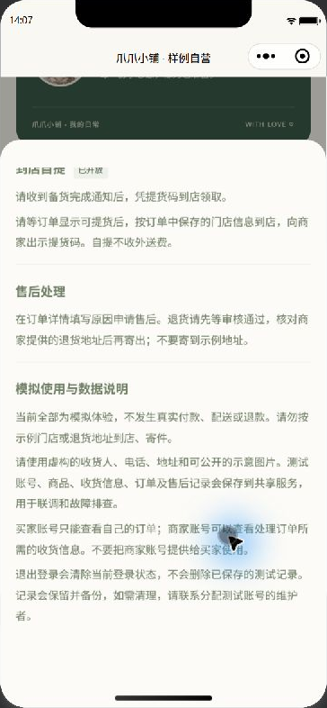
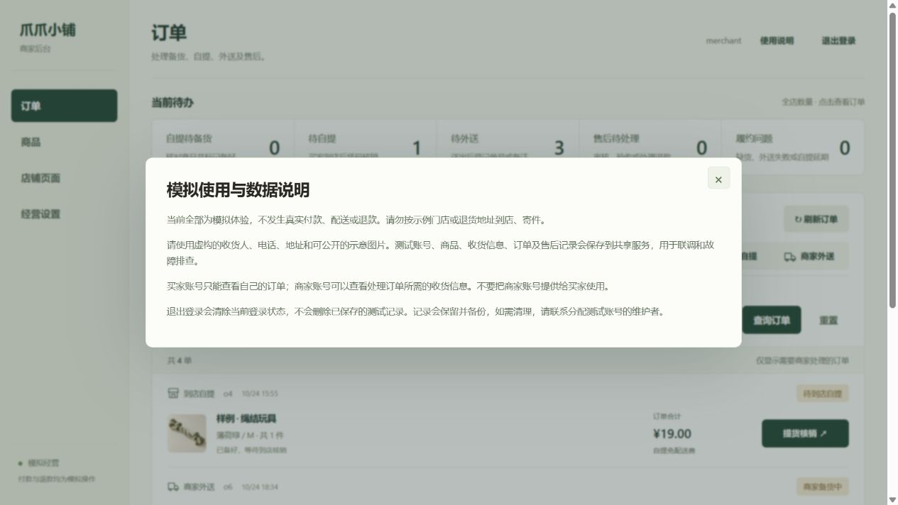

# 模拟使用与数据说明

当前使用模拟门店、商品和收货资料。小程序侧在登录页及“个人中心 → 联系商家”提供说明；服务侧在登录页及顶部“使用说明”提供同一份内容。

说明覆盖不发生真实付款、配送或退款，请勿按示例地址到店或寄件，测试记录的保存与用途，买家和商家的访问范围，以及退出登录不等于删除记录。需要清理测试记录时联系分配账号的维护者。内容由共享模块维护，不新增接口、数据库字段或确认步骤。

## 验收记录

2026-10-26 在已登录的实际小程序模拟器中打开说明并滚动到末尾，全部文字可读；在商家网页点击“使用说明”，弹层完整显示。登录页入口通过代码及官方 WXML/WXSS 编译检查，本轮没有退出已有账号来重复登录验收。

- 完整自动测试：228 项通过，0 失败、0 跳过；99 项语法与 JSON 检查通过。
- 本轮只读取页面，没有新增、修改或删除共享商品、订单及库存。
- 当前说明适用于模拟联调。正式营业时仍须根据实际经营和数据处理情况提供正式说明，并单独验收真实身份及支付接入。

